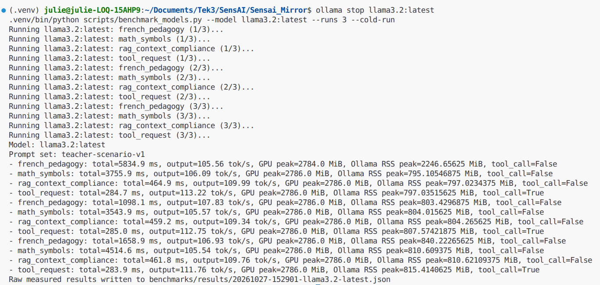

# Local model benchmark protocol

[Home](../README.md) · [Product scenario](products-scenario.md) · [Configuration reference](configuration.md) · [Cost-benefit analysis](cost-benefit.md)

This document records a reproducible comparison of local Ollama models for the SensAI teacher-assistant scenario. It separates **measured values** from model-library sizes and from the team's decision based on them.

It also defines how to measure the local impact of changing a model's temperature,
context window, and supplied RAG context. No value is inferred when the local machine
cannot expose it.

## Benchmark environment

The following values were observed on the benchmark machine on 2026-10-27. They are not estimates.

| Component | Observed value |
| --- | --- |
| Operating system | Ubuntu 26.04.1 LTS, kernel 7.0.0-38-generic |
| CPU | AMD Ryzen 7 8845HS w/ Radeon 780M Graphics |
| System RAM | 14 GiB total; 3.4 GiB available during the initial capture |
| Swap | 4.0 GiB total; 2.3 GiB used during the initial capture |
| Dedicated GPU | NVIDIA GeForce RTX 4060 Laptop GPU |
| Dedicated VRAM | 8,188 MiB total; 21 MiB used during the initial capture |
| NVIDIA driver / CUDA | 580.178.04 / CUDA 13.0 |
| Ollama | 0.24.0 |

The first capture was not an idle-memory measurement: swap was already in use. Every benchmark result must therefore include the available RAM and VRAM recorded by the benchmark script at the start of the run.

A second machine with unified memory (Apple M5) was measured later with a shorter
protocol; see [Second machine: Apple M5](#second-machine-apple-m5-unified-memory).

## Candidate models

| Role | Model | Model-library size | Status |
| --- | --- | --- | --- |
| Former baseline | `llama3.2:latest` | 2.0 GB locally installed | Measured on 2026-10-27 |
| Selected default | `qwen2.5:3b` | 1.9 GB locally installed | Approved on 2026-10-27 |
| Larger candidate | `qwen2.5:7b` | 4.7 GB locally installed | Measured on 2026-10-27 |
| Deliberately excluded candidate | `qwen2.5:14b` | 9.0 GB in the Ollama library | Not downloaded or benchmarked |

`llama3.2:latest` reports 3.21B parameters, Q4_K_M quantization, and tool capability on the benchmark machine. Qwen 2.5 officially supports French; its 3B variant is the selected default and its 7B variant is the larger candidate. [Ollama: Llama 3.2](https://ollama.com/library/llama3.2) · [Ollama: Qwen 2.5](https://ollama.com/library/qwen2.5)

The 14B candidate is not declared impossible: Ollama can potentially offload a model between GPU and RAM. It is excluded from this protocol because its 9.0 GB library size exceeds the measured 8,188 MiB dedicated VRAM, while the benchmark machine has limited available RAM and active swap. This is a hardware-risk decision, not a measured performance result.

## Fixed protocol

All candidates must use the same conditions:

- prompt set: `benchmarks/prompts.json`, version `teacher-scenario-v1`;
- four cases: French pedagogy, mathematical symbols, supplied RAG context, and tool-request recognition;
- temperature: `0.2`, matching the SensAI default configuration;
- context window: `4096`, matching `config.json`;
- three repetitions per prompt case;
- no other Ollama requests while a model is running;
- one manually prepared cold first request, followed by warm requests while the model stays loaded for ten minutes;
- fictional prompts and context only: do not put real pupil data in benchmark output.

The RAG case measures whether a model follows supplied RAG context; it does **not** benchmark vector retrieval quality. The tool case measures whether the model asks for the provided `get_time` tool; it does **not** execute the tool. SensAI integration tests cover retrieval and tool execution separately.

## Measurements and definitions

The benchmark script calls Ollama's streaming `/api/chat` endpoint. Ollama returns `load_duration`, `total_duration`, `prompt_eval_count`, `prompt_eval_duration`, `eval_count`, and `eval_duration` in the final response. The official API defines these duration fields in nanoseconds and the count fields as input/output tokens. [Ollama chat API](https://docs.ollama.com/api/chat)

| Measure | Source | Meaning |
| --- | --- | --- |
| First text-token latency | Script wall clock | Time from request start until the first non-empty text chunk arrives. A tool-only reply can have no text token; its first response event is recorded separately. |
| Total response latency | Script wall clock and Ollama `total_duration` | End-to-end locally observed duration; compare both values to identify client overhead. |
| Output tokens/second | `eval_count / eval_duration` | Ollama-reported generation throughput. |
| Input tokens/second | `prompt_eval_count / prompt_eval_duration` | Ollama-reported prompt-processing throughput. Cached tokens may affect this value. |
| RAM | `/proc/meminfo` and Ollama process RSS | Start/minimum available RAM, its measured drop, and peak RSS of local Ollama processes. |
| VRAM | `nvidia-smi` sampling | Start, peak, and delta NVIDIA VRAM plus peak GPU utilisation. No AMD iGPU VRAM value is claimed. |
| Quality | Manual review | A reviewer checks the fixed criteria saved alongside every response. |
| Tool behaviour | Streamed response | Whether the model emitted a `get_time` tool call with the provided schema. |

Each result JSON also records the selected model, temperature, context window, enabled
benchmark features (`rag`, `tools`, and `memory`), and a prompt-version label. The
benchmark does not simulate persistent conversation memory, so `memory` is explicitly
recorded as `false` rather than implied.

### Measured versus estimated tokens

The benchmark's output tokens per second is measured by Ollama: it divides the final
response's `eval_count` by `eval_duration`. It is a generation-throughput measure, not
a cost estimate. The `/metrics` dashboard instead displays **estimated tokens** when
the streaming response did not report token counts; SensAI estimates them as one token
per four characters. Estimated counts are useful for observing relative session usage,
but must not be compared directly with benchmark output tokens per second or treated as
provider billing data.

### Unavailable metrics

The script prints `unavailable` and writes `null` to its JSON result when a metric
cannot be measured. RAM requires Linux `/proc` information and the Ollama process to
be visible to the current user. VRAM and GPU utilisation require `nvidia-smi`, so they
are unavailable on AMD-only machines, unsupported NVIDIA drivers, remote Ollama
servers, or restricted environments. No substitute VRAM value is invented.

## Run commands

Run these commands from the repository root with Ollama running. The script only reads the installed model and writes JSON result files under `benchmarks/results/`; it does not download, delete, or reconfigure models.

The result JSON files are **Git-ignored** (`benchmarks/results/*.json` in
[`.gitignore`](../.gitignore)) because they contain raw model output and hardware details.
The committed evidence is therefore the tables and screenshots in this document; keep your
own JSON files if you need to re-check a value.

```bash
python3 scripts/benchmark_models.py --model llama3.2:latest --runs 3
python3 scripts/benchmark_models.py --model qwen2.5:3b --runs 3
python3 scripts/benchmark_models.py --model qwen2.5:7b --runs 3
```

To make the first request a documented cold request for a model, stop it immediately
before its benchmark, then verify that no model is loaded and that NVIDIA VRAM has
returned close to its idle baseline (21 MiB on this benchmark machine):

```bash
ollama stop llama3.2:latest
ollama ps
nvidia-smi --query-gpu=memory.used,memory.total --format=csv,noheader
python3 scripts/benchmark_models.py --model llama3.2:latest --runs 3 --cold-run
```

Repeat this sequence for `qwen2.5:3b` and `qwen2.5:7b`. The `--cold-run` flag labels only the first prompt of the first repetition as cold; the remaining requests are warm. Use `ollama ps` immediately after each run to verify where Ollama placed the model.

```bash
ollama ps
```

For a visual evidence capture, use a second terminal while each command runs:

```bash
watch -n 0.5 'date "+%H:%M:%S"; echo "--- Ollama ---"; ollama ps; echo "--- NVIDIA ---"; nvidia-smi --query-gpu=memory.used,memory.total,utilization.gpu --format=csv,noheader; echo "--- RAM ---"; free -h | sed -n "2p"'
```

The captures taken this way are committed as `docs/images/benchmarks/llama3.2.png`,
`qwen2.5-3b.png`, and `qwen2.5-7b.png`, and shown below the
[results table](#results-table---measured-on-2026-10-27).

## Configuration-impact comparison

Use the selected default model and keep all unrelated activity off the machine. These
four commands run the same prompt set three times and write one self-describing JSON
file per configuration. Do **not** compare the first cold request across these files:
the goal is to compare warm request behaviour after the model is loaded.

### Benchmark command parameters

General form:

```bash
python3 scripts/benchmark_models.py --model <model> [options]
```

| Parameter | Example | Purpose |
| --- | --- | --- |
| `--model` | `qwen2.5:3b` | Required. Name of an already installed Ollama model to test. Check available names with `ollama list`. |
| `--runs` | `3` | Number of repetitions for **each** prompt case. Three runs reduce the impact of a one-off slow response. |
| `--warmup` | `--warmup` | Sends one unrecorded request first, so Ollama loads the model before measurements begin. Use for fair warm-run comparisons. |
| `--cold-run` | `--cold-run` | Labels the first measured request as cold, after manually running `ollama stop <model>`. Do not combine it with `--warmup`. |
| `--temperature` | `0.2` | Sampling randomness from `0` to `2`. Low values produce more stable wording; higher values produce more varied wording. |
| `--context-window` | `4096` | Maximum context capacity, in tokens, for the benchmark request. A larger value can use more RAM and VRAM. |
| `--rag` | `enabled` | Chooses whether the fixed RAG prompt case contains its document excerpt: `enabled` or `disabled`. This does not run the full SQLite retrieval pipeline. |
| `--prompt-version` | `teacher-v1` | A label saved in the JSON result, used to compare measurements made before and after a prompt change. It does not change the prompt by itself. |
| `--label` | `baseline` | A readable label appended to the result filename, for example `...-qwen2.5-3b-baseline.json`. |
| `--base-url` | `http://localhost:11434` | Optional Ollama server URL. Keep the default for a local Ollama server. |
| `--prompts` | `benchmarks/prompts.json` | Optional path to the fixed prompt-set JSON file. Change it only when intentionally benchmarking another documented prompt set. |
| `--results-dir` | `benchmarks/results` | Optional directory in which the script writes raw JSON measurements. |

Use `python3 scripts/benchmark_models.py --help` to display the parameters directly in
the terminal. The script never downloads, changes, or deletes a model.

Before **each** configuration, reset the loaded model, then run the corresponding
command below. This avoids treating Ollama's retained process memory as a configuration
effect. `--warmup` immediately reloads it with one unrecorded request, so the three
recorded requests are still warm measurements.

```bash
ollama stop qwen2.5:3b
```

```bash
python3 scripts/benchmark_models.py --model qwen2.5:3b --runs 3 --warmup --temperature 0.2 --context-window 4096 --rag enabled --prompt-version teacher-v1 --label baseline
python3 scripts/benchmark_models.py --model qwen2.5:3b --runs 3 --warmup --temperature 0.8 --context-window 4096 --rag enabled --prompt-version teacher-v1 --label temperature-0.8
python3 scripts/benchmark_models.py --model qwen2.5:3b --runs 3 --warmup --temperature 0.2 --context-window 8192 --rag enabled --prompt-version teacher-v1 --label context-8192
python3 scripts/benchmark_models.py --model qwen2.5:3b --runs 3 --warmup --temperature 0.2 --context-window 4096 --rag disabled --prompt-version teacher-v1 --label rag-disabled
```

`--warmup` loads the model using one unrecorded request, so the three recorded repetitions are comparable warm runs. The `--cold-run` option is intentionally separate: run `ollama stop <model>` immediately before a cold measurement, then compare cold first-token latency only with other cold measurements. Do not combine `--cold-run` and `--warmup`.

For each file, compare warm first-text latency, warm total latency, Ollama-reported
input/output tokens per second, peak process RSS, and peak VRAM. The `--rag disabled` run
removes the fixed context from the RAG prompt case and instructs the model to state in
one sentence that the answer is absent; it measures the cost of context injection, not
document retrieval, embedding generation, or SQLite search.

The terminal summary shows `first_text` (time to the first streamed text fragment) and
`first_event` (time to the first text fragment **or** tool-call event). A pure tool-call
response can therefore report `first_text=unavailable` while still reporting a measured
`first_event`; this is expected and is not replaced with a fabricated token latency.

The enabled and disabled RAG responses intentionally have different output lengths.
Compare their `prompt_eval_count`, `input_tokens_per_second`, and first-text latency to
study prompt processing. Do not claim that the difference in total latency alone is the
cost of RAG, because it also includes different response generation work.

| Compared setting | What the measurement can show | Expected trade-off to verify locally |
| --- | --- | --- |
| Temperature `0.2` versus `0.8` | Changes in answer length, response variation, latency, and generation throughput. | Higher temperature generally produces more varied wording; it does not guarantee better pedagogy or a fixed latency change. |
| Context window `4096` versus `8192` | Effect of `num_ctx` on allocation and short-prompt latency. | A larger capacity can require more RAM/VRAM. A short prompt may show little or no latency difference because it does not fill the extra context. |
| RAG enabled versus disabled | Effect of injecting retrieved context into the model request. | More context can improve grounded answers, while increasing prompt-processing work and potentially latency/RAM use. It cannot guarantee that a response is factually correct. |

The measurements below were run consecutively on 2026-10-30 on the RTX 4060 machine. Their
RSS values are real measurements, but should not be used to compare configurations because
the model was not stopped between each run. Re-run with the reset step above for a fair RAM
comparison.

| Configuration label | Warm first text (ms) | Warm total latency (ms) | Input tok/s | Output tok/s | Peak RSS (MiB)* | Peak VRAM (MiB) | Observation |
| --- | ---: | ---: | ---: | ---: | ---: | ---: | --- |
| `baseline` | 89.93 | 1228.03 | 4544.62 | 110.35 | 1170.99 | 2465 | Reference warm run. |
| `temperature-0.8` | 90.23 | 1466.61 | 4593.74 | 111.60 | 1219.83 | 2467 | Similar first-text latency and throughput; longer generated answers made total latency higher. |
| `context-8192` | 90.19 | 1168.83 | 4597.41 | 111.96 | 1242.15 | 2609 | Short prompts showed no material latency loss; VRAM peak increased by 144 MiB. |
| `rag-disabled` | 87.64 | 1143.56 | 4494.49 | 112.90 | 1271.86 | 2465 | The RAG case used 85 input tokens instead of 120 and processed them at 3929.35 tok/s, versus 4228.11 tok/s with context. Its different output length prevents a total-latency-only comparison. |

\* Not comparable between rows: the model was not stopped between these runs (see above).

The +144 MiB VRAM of `context-8192` is exactly the KV-cache size predicted for 4,096 extra
tokens of `qwen2.5:3b` (36 KiB per token); the calculation is in
[context engineering](context-engineering.md#4-size-management).

## Quality-review protocol

For each model and each prompt case, inspect the `response_text`, `tool_calls`, and `manual_quality_checks` fields in the generated JSON result. Mark every check **pass**, **partial**, or **fail**, then record a short factual note. Do not alter the prompt set between models.

Minimum pass conditions for a practical default model:

- all French-pedagogy checks pass;
- all mathematical-symbol checks pass;
- the RAG-context answer does not add unsupported information;
- the tool prompt emits a valid `get_time` request;
- no crash, sustained memory exhaustion, or unreliable GPU/CPU fallback occurs across three repetitions.

The latency targets used for the decision were a first text token below 3 seconds and a
short response below 15 seconds. They are **project targets**, not measured results. In the
table below, all three models met both targets on warm requests; on the cold request, only
`qwen2.5:3b` met the 3-second first-token target (2,254.9 ms, versus 4,370.4 ms for
`llama3.2:latest` and 7,572.8 ms for `qwen2.5:7b`).

## Results table - measured on 2026-10-27

The values below come from these clean generated JSON files in `benchmarks/results/`.
They are Git-ignored, so they exist only on the benchmark machine; this table and the
screenshots below are the committed record.

- `20261027-152901-llama3.2-latest.json`
- `20261027-154641-qwen2.5-3b.json`
- `20261027-155029-qwen2.5-7b.json`

Each **warm mean** is the arithmetic mean of the eleven warm requests: three prompt
cases with text, plus the tool-only case, repeated three times, excluding the one
labelled cold request. First-text-token latency excludes tool-only replies because
they do not contain text.

The Llama cold result and the repeated Qwen 3B and Qwen 7B cold results all began
from 21 MiB of used NVIDIA VRAM. They are therefore comparable cold-run observations.
The earlier Qwen results that began with 2,786 MiB or 5,208 MiB already in use are
superseded by these clean runs.

| Model | Run condition | First text token (ms) | Total latency (ms) | Output tok/s | Input tok/s | Peak Ollama RSS (MiB) | Peak VRAM (MiB) | Quality review | RAG-context result | Tool-call result | Status |
| --- | --- | ---: | ---: | ---: | ---: | ---: | ---: | --- | --- | --- | --- |
| `llama3.2:latest` | Cold verified; warm mean | Cold: 4,370.4<br>Warm: 106.7 | Cold: 5,834.9<br>Warm: 1,528.3 | Cold: 105.6<br>Warm: 109.0 | Cold: 3,213.7<br>Warm: 5,072.7 | Cold: 2,246.7<br>Warm peak: 840.2 | Cold: 2,784.0<br>Warm peak: 2,786.0 | Manual review pending | 3/3 replies stayed within the supplied context | 3/3 calls emitted; 0/3 had valid empty arguments | Measured; tool schema needs improvement |
| `qwen2.5:3b` | Cold verified; warm mean | Cold: 2,254.9<br>Warm: 99.5 | Cold: 2,992.7<br>Warm: 1,204.7 | Cold: 106.7<br>Warm: 111.0 | Cold: 3,293.7<br>Warm: 4,189.3 | Cold: 2,339.3<br>Warm peak: 949.3 | Cold: 2,442.0<br>Warm peak: 2,444.0 | Team review accepted | 3/3 replies stayed within the supplied context | 3/3 valid `get_time` calls | Measured; selected default |
| `qwen2.5:7b` | Cold verified; warm mean | Cold: 7,572.8<br>Warm: 118.1 | Cold: 9,778.4<br>Warm: 3,198.7 | Cold: 48.9<br>Warm: 53.7 | Cold: 1,072.9<br>Warm: 2,147.8 | Cold: 4,009.6<br>Warm peak: 681.4 | Cold: 4,856.0<br>Warm peak: 4,858.0 | Manual review pending | 3/3 replies stayed within the supplied context | 3/3 valid `get_time` calls | Measured; roughly half the 3B generation throughput |




## Second machine: Apple M5 (unified memory)

Measured on 2026-11-01 with a shorter protocol, to check that the decision holds on a
Mac and to compare generation speed across machines.

| Component | Observed value |
| --- | --- |
| Machine | Apple M5, 16 GB unified memory shared by CPU and GPU |
| Operating system | macOS 26.6.2 |
| Ollama | 0.40.7, Metal backend |
| GPU memory budget | 12,713 MB (`recommendedMaxWorkingSetSize` in `~/.ollama/logs/server.log`) |

How the values were taken:

- direct call to Ollama `/api/chat` with `stream: false`, temperature `0.2`, and `num_ctx`
  `4096`; output tokens/second is `eval_count / eval_duration` from the final response;
- one prompt, the main request of the demonstration: *"Rédige une activité de 15 minutes
  sur les fractions équivalentes pour une classe de 6e."* It is not the four-case prompt
  set above, so latencies are not comparable with the RTX table; throughput is;
- three runs per model; run 1 is cold (`ollama stop <model>` first), runs 2 and 3 are warm;
  `ollama ps` showed no other loaded model before and after each series;
- memory is the `SIZE` column of `ollama ps` right after the runs. Unified memory has no
  separate VRAM to sample, and `scripts/benchmark_models.py` reads RAM from Linux `/proc`
  and VRAM from `nvidia-smi`, neither of which exists on macOS.

| Model | Output tok/s (runs 1 / 2 / 3) | Output tokens | Total duration (s) | Cold load (s) | `ollama ps` size |
| --- | ---: | ---: | ---: | ---: | --- |
| `qwen2.5:3b` | 58.3 / 58.1 / 58.7 | 517 / 622 / 550 | 10.25 / 10.73 / 9.40 | 1.30 | 2.2 GB at `num_ctx` 4096; 2.4 GB at 8192 |
| `llama3.2:latest` | 56.7 / 56.2 / 56.1 | 508 / 529 / 583 | 10.35 / 9.45 / 10.42 | 1.30 | 2.6 GB at `num_ctx` 4096 |
| `granite3.1-moe:latest` (not a candidate, Mixture-of-Experts illustration) | 144.9 / 149.6 / 152.4 | 782 / 959 / 848 | 6.72 / 6.43 / 5.59 | 1.03 | 2.4 GB at `num_ctx` 4096 |

An earlier session on the same day, with the same method, gave 58.8 / 58.9 / 59.2 tok/s
for `qwen2.5:3b` and 56.3–56.6 tok/s for `llama3.2:latest`.

Prompt processing (prefill) was measured separately on a 2,050-token prompt whose first
line changed at every run: 1,399 / 1,507 / 1,517 tok/s for `qwen2.5:3b`, that is 1.35–1.47 s
for the whole prompt. Prefill rates computed on the repeated 55-token prompt above are not
used: Ollama can reuse its prompt cache for an identical prompt while `prompt_eval_count`
still reports the full prompt (it returned 1,570 tokens twice for the same 1,570-token
prompt).

What this second machine shows:

- the ranking holds: `qwen2.5:3b` is 3.6% faster than `llama3.2:latest` (mean 58.4 versus
  56.3 tok/s) and uses 0.4 GB less memory. Tool-call validity was not re-measured here;
- the M5 generates at 0.53 times the RTX 4060 speed for `qwen2.5:3b` (58.4 / 111.0), close
  to the ratio of their memory bandwidths (153 / 256 GB/s = 0.60). Generation is limited by
  memory bandwidth, not by compute
  explains the calculation and the theoretical ceilings (79 and 133 tok/s);
- the 15-minute activity (517–622 output tokens) took 9.4–10.7 s in total on the M5;
  almost all of it is generation (output tokens / 58 tok/s).

Reproduce one measurement:

```bash
ollama stop qwen2.5:3b
curl -s http://localhost:11434/api/chat -d '{"model": "qwen2.5:3b", "stream": false,
  "options": {"temperature": 0.2, "num_ctx": 4096},
  "messages": [{"role": "user", "content": "Rédige une activité de 15 minutes sur les fractions équivalentes pour une classe de 6e."}]}' \
  | python3 -c 'import json,sys; r=json.load(sys.stdin); print(r["eval_count"], "tokens,", round(r["eval_count"] / r["eval_duration"] * 1e9, 1), "tok/s, load", round(r["load_duration"] / 1e9, 2), "s")'
ollama ps
grep recommendedMaxWorkingSetSize ~/.ollama/logs/server.log | tail -1
```

## Approved decision record

| Decision | Model | Evidence required before approval |
| --- | --- | --- |
| Recommended default | `qwen2.5:3b` | Team-approved after the benchmark comparison: it produced valid tool calls in 3/3 attempts, a verified cold first-text latency of 2,254.9 ms, and the best warm total-latency mean (1,204.7 ms), with 111.0 output tok/s. `config.json` uses this model. |
| Fallback model | `llama3.2:latest` | It reached 109.0 output tok/s with a warm VRAM peak of 2,786 MiB (342 MiB more than Qwen 3B), but produced invalid `get_time` arguments in 3/3 attempts. It is configured as the automatic fallback when Qwen 3B is missing locally. |
| Usable larger candidate, not selected as default | `qwen2.5:7b` | It ran reliably and produced valid tool calls in 3/3 attempts, but its verified cold total latency was 9,778.4 ms and its warm output speed was 53.7 tok/s: about half the Qwen 3B throughput. It remains an option if a future quality review demonstrates a meaningful quality advantage. |
| Not practical | `qwen2.5:14b` | Documented pre-benchmark hardware risk: 9.0 GB library size exceeds 8,188 MiB VRAM. |

The team approved Qwen 3B as the default chat model. Keep the raw JSON results with
their date, model name, and prompt-set version so another team member can reproduce
the conclusion and reassess it after a model, prompt, or hardware change. Because they are
Git-ignored, copy the values that matter into this document before deleting them.

Two points from the other defense documents affect this decision: `qwen2.5:3b` is
distributed under the Qwen Research License (non-commercial, "research or evaluation
purposes only"), and its answers still need teacher review. See
the model cards and the
[cost-benefit analysis](cost-benefit.md).
