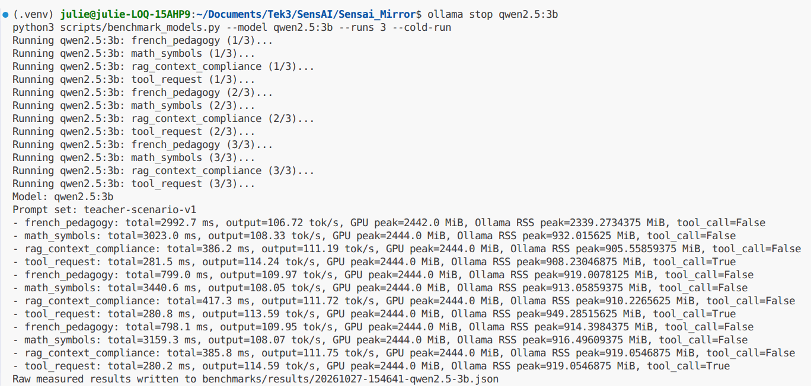
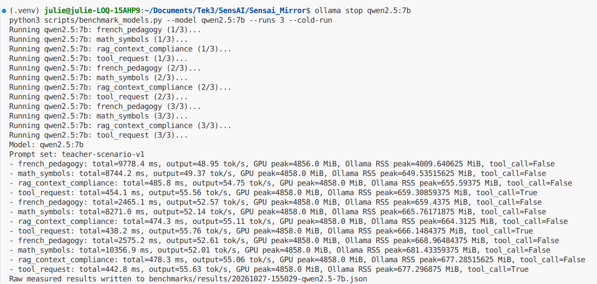

# Local model benchmark protocol

[Home](../README.md) · [Product scenario](products-scenario.md) · [Configuration reference](configuration.md)

This document records a reproducible comparison of local Ollama models for the SensAI teacher-assistant scenario. It separates **measured values** from model-library sizes and from recommendations that still need benchmark evidence.

## Benchmark environment

The following values were observed on the benchmark machine on 2026-10-27. They are not estimates.

| Component | Observed value |
| --- | --- |
| Operating system | Ubuntu 26.04.1 LTS, kernel 7.0.0-38-generic |
| CPU | AMD Ryzen 7 8845HS w/ Radeon 780M Graphics |
| System RAM | 14 GiB total; 3.4 GiB available during the initial capture |
| Swap | 4.0 GiB total; 2.3 GiB used during the initial capture |
| Dedicated GPU | NVIDIA GeForce RTX 4060 Laptop GPU |
| Dedicated VRAM | 8,188 MiB total; 21 MiB used during the initial capture |
| NVIDIA driver / CUDA | 580.178.04 / CUDA 13.0 |
| Ollama | 0.24.0 |

The first capture was not an idle-memory measurement: swap was already in use. Every benchmark result must therefore include the available RAM and VRAM recorded by the benchmark script at the start of the run.

Add the terminal capture supplied for this environment here after copying it into the repository:

```markdown

```

## Candidate models

| Role | Model | Model-library size | Status |
| --- | --- | --- | --- |
| Former baseline | `llama3.2:latest` | 2.0 GB locally installed | Measured on 2026-10-27 |
| Selected default | `qwen2.5:3b` | 1.9 GB locally installed | Approved on 2026-10-27 |
| Larger candidate | `qwen2.5:7b` | 4.7 GB locally installed | Measured on 2026-10-27 |
| Deliberately excluded candidate | `qwen2.5:14b` | 9.0 GB in the Ollama library | Not downloaded or benchmarked |

`llama3.2:latest` reports 3.21B parameters, Q4_K_M quantization, and tool capability on the benchmark machine. Qwen 2.5 officially supports French; its 3B variant is the selected default and its 7B variant is the larger candidate. [Ollama: Llama 3.2](https://ollama.com/library/llama3.2) · [Ollama: Qwen 2.5](https://ollama.com/library/qwen2.5)

The 14B candidate is not declared impossible: Ollama can potentially offload a model between GPU and RAM. It is excluded from this protocol because its 9.0 GB library size exceeds the measured 8,188 MiB dedicated VRAM, while the benchmark machine has limited available RAM and active swap. This is a hardware-risk decision, not a measured performance result.

## Fixed protocol

All candidates must use the same conditions:

- prompt set: `benchmarks/prompts.json`, version `teacher-scenario-v1`;
- four cases: French pedagogy, mathematical symbols, supplied RAG context, and tool-request recognition;
- temperature: `0.2`, matching the SensAI default configuration;
- context window: `4096`, matching `config.json`;
- three repetitions per prompt case;
- no other Ollama requests while a model is running;
- one manually prepared cold first request, followed by warm requests while the model stays loaded for ten minutes;
- fictional prompts and context only: do not put real pupil data in benchmark output.

The RAG case measures whether a model follows supplied RAG context; it does **not** benchmark vector retrieval quality. The tool case measures whether the model asks for the provided `get_time` tool; it does **not** execute the tool. SensAI integration tests cover retrieval and tool execution separately.

## Measurements and definitions

The benchmark script calls Ollama's streaming `/api/chat` endpoint. Ollama returns `load_duration`, `total_duration`, `prompt_eval_count`, `prompt_eval_duration`, `eval_count`, and `eval_duration` in the final response. The official API defines these duration fields in nanoseconds and the count fields as input/output tokens. [Ollama chat API](https://docs.ollama.com/api/chat)

| Measure | Source | Meaning |
| --- | --- | --- |
| First text-token latency | Script wall clock | Time from request start until the first non-empty text chunk arrives. A tool-only reply can have no text token; its first response event is recorded separately. |
| Total response latency | Script wall clock and Ollama `total_duration` | End-to-end locally observed duration; compare both values to identify client overhead. |
| Output tokens/second | `eval_count / eval_duration` | Ollama-reported generation throughput. |
| Input tokens/second | `prompt_eval_count / prompt_eval_duration` | Ollama-reported prompt-processing throughput. Cached tokens may affect this value. |
| RAM | `/proc/meminfo` and Ollama process RSS | Start/minimum available RAM, its measured drop, and peak RSS of local Ollama processes. |
| VRAM | `nvidia-smi` sampling | Start, peak, and delta NVIDIA VRAM plus peak GPU utilisation. No AMD iGPU VRAM value is claimed. |
| Quality | Manual review | A reviewer checks the fixed criteria saved alongside every response. |
| Tool behaviour | Streamed response | Whether the model emitted a `get_time` tool call with the provided schema. |

## Run commands

Run these commands from the repository root with Ollama running. The script only reads the installed model and writes JSON result files under `benchmarks/results/`; it does not download, delete, or reconfigure models.

```bash
python3 scripts/benchmark_models.py --model llama3.2:latest --runs 3
python3 scripts/benchmark_models.py --model qwen2.5:3b --runs 3
python3 scripts/benchmark_models.py --model qwen2.5:7b --runs 3
```

To make the first request a documented cold request for a model, stop it immediately
before its benchmark, then verify that no model is loaded and that NVIDIA VRAM has
returned close to its idle baseline (21 MiB on this benchmark machine):

```bash
ollama stop llama3.2:latest
ollama ps
nvidia-smi --query-gpu=memory.used,memory.total --format=csv,noheader
python3 scripts/benchmark_models.py --model llama3.2:latest --runs 3 --cold-run
```

Repeat this sequence for `qwen2.5:3b` and `qwen2.5:7b`. The `--cold-run` flag labels only the first prompt of the first repetition as cold; the remaining requests are warm. Use `ollama ps` immediately after each run to verify where Ollama placed the model.

```bash
ollama ps
```

For a visual evidence capture, use a second terminal while each command runs:

```bash
watch -n 0.5 'date "+%H:%M:%S"; echo "--- Ollama ---"; ollama ps; echo "--- NVIDIA ---"; nvidia-smi --query-gpu=memory.used,memory.total,utilization.gpu --format=csv,noheader; echo "--- RAM ---"; free -h | sed -n "2p"'
```

Save one readable capture per model at these paths, then add the image Markdown below the result table:

```text
docs/images/benchmarks/02-llama3.2.png
docs/images/benchmarks/03-qwen2.5-3b.png
docs/images/benchmarks/04-qwen2.5-7b.png
```

## Quality-review protocol

For each model and each prompt case, inspect the `response_text`, `tool_calls`, and `manual_quality_checks` fields in the generated JSON result. Mark every check **pass**, **partial**, or **fail**, then record a short factual note. Do not alter the prompt set between models.

Minimum pass conditions for a practical default model:

- all French-pedagogy checks pass;
- all mathematical-symbol checks pass;
- the RAG-context answer does not add unsupported information;
- the tool prompt emits a valid `get_time` request;
- no crash, sustained memory exhaustion, or unreliable GPU/CPU fallback occurs across three repetitions.

The team must agree on latency thresholds before making the final recommendation. Suggested starting thresholds are first text token below 3 seconds and a short response below 15 seconds, but these are **project targets**, not measured results.

## Results table — measured on 2026-10-27

The values below come from these clean generated JSON files in `benchmarks/results/`:

- `20261027-152901-llama3.2-latest.json`
- `20261027-154641-qwen2.5-3b.json`
- `20261027-155029-qwen2.5-7b.json`

Each **warm mean** is the arithmetic mean of the eleven warm requests: three prompt
cases with text, plus the tool-only case, repeated three times, excluding the one
labelled cold request. First-text-token latency excludes tool-only replies because
they do not contain text.

The Llama cold result and the repeated Qwen 3B and Qwen 7B cold results all began
from 21 MiB of used NVIDIA VRAM. They are therefore comparable cold-run observations.
The earlier Qwen results that began with 2,786 MiB or 5,208 MiB already in use are
superseded by these clean runs.

| Model | Run condition | First text token (ms) | Total latency (ms) | Output tok/s | Input tok/s | Peak Ollama RSS (MiB) | Peak VRAM (MiB) | Quality review | RAG-context result | Tool-call result | Status |
| --- | --- | ---: | ---: | ---: | ---: | ---: | ---: | --- | --- | --- | --- |
| `llama3.2:latest` | Cold verified; warm mean | Cold: 4,370.4<br>Warm: 106.7 | Cold: 5,834.9<br>Warm: 1,528.3 | Cold: 105.6<br>Warm: 109.0 | Cold: 3,213.7<br>Warm: 5,072.7 | Cold: 2,246.7<br>Warm peak: 840.2 | Cold: 2,784.0<br>Warm peak: 2,786.0 | Manual review pending | 3/3 replies stayed within the supplied context | 3/3 calls emitted; 0/3 had valid empty arguments | Measured; tool schema needs improvement |
| `qwen2.5:3b` | Cold verified; warm mean | Cold: 2,254.9<br>Warm: 99.5 | Cold: 2,992.7<br>Warm: 1,204.7 | Cold: 106.7<br>Warm: 111.0 | Cold: 3,293.7<br>Warm: 4,189.3 | Cold: 2,339.3<br>Warm peak: 949.3 | Cold: 2,442.0<br>Warm peak: 2,444.0 | Team review accepted | 3/3 replies stayed within the supplied context | 3/3 valid `get_time` calls | Measured; selected default |
| `qwen2.5:7b` | Cold verified; warm mean | Cold: 7,572.8<br>Warm: 118.1 | Cold: 9,778.4<br>Warm: 3,198.7 | Cold: 48.9<br>Warm: 53.7 | Cold: 1,072.9<br>Warm: 2,147.8 | Cold: 4,009.6<br>Warm peak: 681.4 | Cold: 4,856.0<br>Warm peak: 4,858.0 | Manual review pending | 3/3 replies stayed within the supplied context | 3/3 valid `get_time` calls | Measured; roughly half the 3B generation throughput |





## Approved decision record

| Decision | Model | Evidence required before approval |
| --- | --- | --- |
| Recommended default | `qwen2.5:3b` | Team-approved after the benchmark comparison: it produced valid tool calls in 3/3 attempts, a verified cold first-text latency of 2,254.9 ms, and the best warm total-latency mean (1,204.7 ms), with 111.0 output tok/s. `config.json` uses this model. |
| Fallback model | `llama3.2:latest` | It has the lowest observed warm VRAM peak (2,786 MiB) and 109.0 output tok/s, but produced invalid `get_time` arguments in 3/3 attempts. It is configured as the automatic fallback when Qwen 3B is missing locally. |
| Usable larger candidate, not selected as default | `qwen2.5:7b` | It ran reliably and produced valid tool calls in 3/3 attempts, but its verified cold total latency was 9,778.4 ms and its warm output speed was 53.7 tok/s: about half the Qwen 3B throughput. It remains an option if a future quality review demonstrates a meaningful quality advantage. |
| Not practical | `qwen2.5:14b` | Documented pre-benchmark hardware risk: 9.0 GB library size exceeds 8,188 MiB VRAM. |

The team approved Qwen 3B as the default chat model. Keep the raw JSON results with
their date, model name, and prompt-set version so another team member can reproduce
the conclusion and reassess it after a model, prompt, or hardware change.
